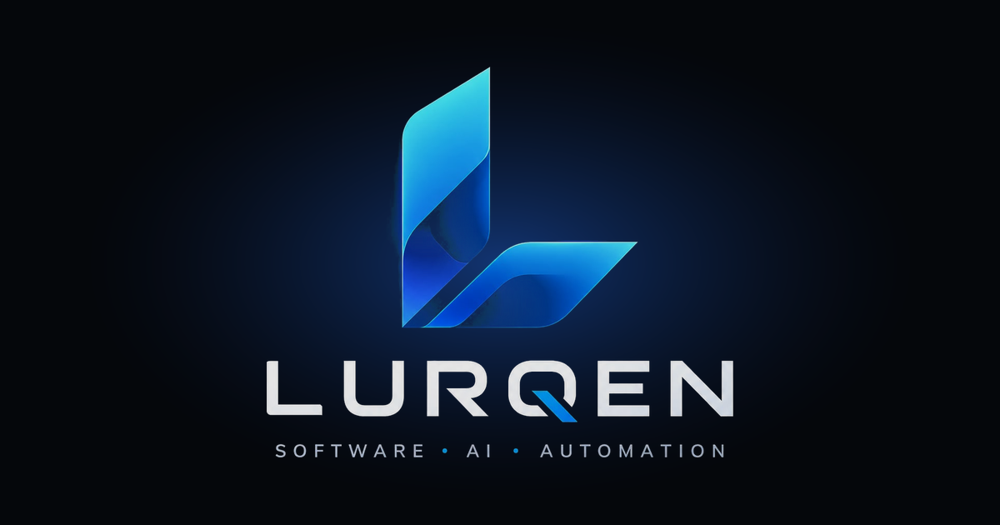

<div align="center">



# LURQEN — sitio web

Landing page de **LURQEN**, marca de software a la medida y automatizaciones con IA.
Diseñada, desarrollada y desplegada de punta a punta por [Luis Peña](https://github.com/LuisPR1050).

**[Ver sitio en vivo →](https://lurqen-web.vercel.app/)**


</div>

---

## Lo más destacado

- **Seguridad desde la configuración.** Cabeceras HTTP endurecidas en `next.config.ts`: Content-Security-Policy restrictiva (solo recursos propios, `frame-ancestors 'none'`, `object-src 'none'`), HSTS con preload, `X-Frame-Options`, `X-Content-Type-Options`, `Referrer-Policy` y `Permissions-Policy`. Además se oculta la cabecera `X-Powered-By`.
- **Cero dependencias externas en tiempo de ejecución.** Fuentes autoalojadas (Inter, Sora, JetBrains Mono) y sin scripts de terceros, lo que permite una CSP estricta y mejora la privacidad del visitante.
- **SEO técnico.** `sitemap.xml`, `robots.txt`, imagen Open Graph e íconos generados desde el App Router.
- **Animaciones con accesibilidad.** Todas las animaciones (Motion) respetan la preferencia del sistema *reducir movimiento*.
- **Contenido desacoplado del código.** Textos, servicios, proyectos y datos de contacto viven en un único archivo tipado: `src/lib/site.ts`.
- **Renderizado estático.** Todas las rutas se prerenderizan; el build y el lint pasan sin errores ni advertencias.

## Stack

| Capa | Tecnología |
| --- | --- |
| Framework | Next.js 16 (App Router, Turbopack) |
| UI | React 19, Tailwind CSS 4, Motion, Lucide |
| Lenguaje | TypeScript |
| Calidad | ESLint (`eslint-config-next`) |
| Despliegue | Vercel |

## Estructura

```
src/
  app/            layout, página y SEO (sitemap, robots, íconos, imagen para redes)
  components/     una sección por archivo (Hero, Services, Projects, Process…)
    ui/           componentes reutilizables (Button, RevealText, BrowserFrame…)
  fonts/          fuentes autoalojadas (licencia SIL OFL)
  lib/site.ts     datos editables del sitio
public/           logos y capturas de proyectos
```

## Secciones animadas

| Componente | Comportamiento |
| --- | --- |
| `RevealText` | Los titulares aparecen palabra por palabra. |
| `Hero` | Capturas con parallax y tarjeta de automatización que rota sola. |
| `Marquee` | Cinta continua con los tipos de soluciones. |
| `Projects` | Visor de capturas con pestañas y rotación automática. |
| `BuildStory` | Con el scroll se ilumina cada frase y el mockup del celular se arma por partes. |
| `Process` | La línea de tiempo se llena según el avance del scroll. |

## Ejecutar en local

Requisito: Node.js 20 o superior.

```bash
git clone https://github.com/LuisPR1050/lurqen-web.git
cd lurqen-web
npm install
npm run dev        # http://localhost:3000
```

Otros comandos:

```bash
npm run build      # build de producción
npm run lint       # análisis estático
```

> Si agregas un script o servicio externo (analítica, chat, etc.), añade su dominio a la CSP en `next.config.ts`.

## Autor

**Luis Peña** — Desarrollador de software y estudiante de Ingeniería de Software con enfoque en ciberseguridad.
Bogotá, Colombia · [LinkedIn](https://www.linkedin.com/in/luis-alberto-pe%C3%B1a-ruidiaz-a6b4092aa) · [GitHub](https://github.com/LuisPR1050)
